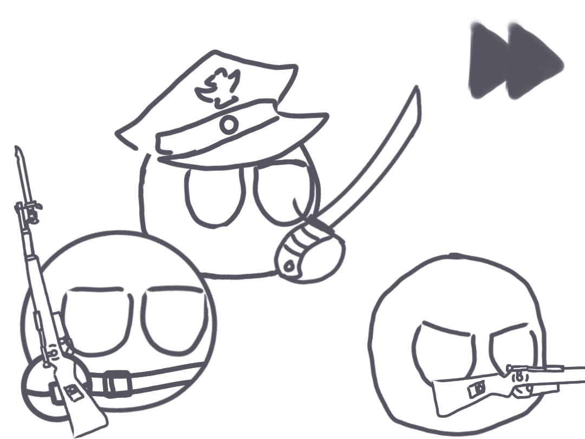

# RwR - 2D 战术射击游戏

一个由我在暑假无聊开发的 2D 俯视角战术射击游戏，基于原生 JavaScript + Canvas 实现。

无框架、无构建工具、无外部依赖 —— 浏览器打开即玩。

---

## 🎮 三种模式

主菜单悬停任意模式会弹出右侧预览卡片，点击即进入。

<table>
  <tr>
    <td align="center"><b>🚩 战地模式</b></td>
    <td align="center"><b>⚡ 快速模式</b></td>
    <td align="center"><b>🎬 战役模式</b></td>
  </tr>
  <tr>
    <td align="center"></td>
    <td align="center"></td>
    <td align="center"></td>
  </tr>
</table>

| 模式 | 状态 | 玩法 |
|------|:----:|------|
| 🚩 **战地模式** | ✅ | 大地图据点攻防。占领据点、经营 RP、呼叫支援、推进战线，完整沙盒体验。 |
| ⚡ **快速模式** | ✅ | 小地图遭遇战。随机武器开局，全歼敌人即胜利，阵亡即失败。结算后可「重试」（同配置）或「下一把」（重新随机）。 |
| 🎬 **战役模式** | 🚧 | 多关卡剧情推进，关卡目标与过场演出。基础设施已就位，内容制作中，敬请期待。 |

---

## ✨ 特性

**战斗**
- 🔫 多类武器：手枪 / 步枪 / 冲锋枪 / 霰弹枪 / 狙击枪 / 火箭筒 / 榴弹发射器
- 📡 电台呼叫支援：空投、火炮、伞兵、烟雾、武器空投，以及 MQ-9 死神、A-10 疣猪空中支援
- 🤖 敌方支援 AI：军官 / 指挥官会消耗 RP 呼叫火炮与伞兵
- 🚙 载具：威利斯 MB 吉普 + BTR-80 装甲车（机炮 / 同轴机枪 / 炮塔旋转）
- 🪖 头盔系统：减伤 + 概率跳弹
- 🎖️ 军衔 / 兵种系统，星数解锁高级支援

**世界**
- 🗺️ 随机地图：草地、森林、河流、房屋、山地、道路、沙地
- 🌤️ 18 种天气 + 🌅 昼夜循环（动态光照）
- 🌪️ 龙卷风：Catmull-Rom 路径、EF 等级与形态系统、超级单体
- ✨ WebGL 后处理：Bloom 辉光、积水反射
- 🔊 三层环境混音（天气 + 昼夜 + 地形），无缝循环

**系统**
- 🎒 战利品：4 稀有度（普通 / 优良 / 稀有 / 传说），掉落 / 拾取 / 背包 / 出售 / 丢弃
- 🤝 AI 队友协作（最多 50 人）+ AI 闲聊
- 🪟 液态毛玻璃 UI：背包 / 武器 HUD / 电台 / 状态效果统一风格，含缓动动画

---

## 🕹️ 操作

| 按键 | 功能 |
|------|------|
| `WASD` | 移动 |
| 鼠标左键 / `空格` | 射击 |
| `1`–`7` | 切换武器 / 战利品；车内切换座位 |
| `Q` | 背包 |
| `E` | 军械库（需靠近） |
| `F` | 拾取 / 上下车 |
| `G` | 短按投手雷，长按开电台 |
| `R` | 换弹 |
| `H` | 载具喇叭 |
| `K` | 自杀 |
| `9`+`1` | Debug 面板 |

---

## 📁 项目结构

```
RwR/
├── index.html                 # 游戏入口
├── README.md
│
└── src/
    ├── main.js                # 主循环与初始化
    │
    ├── campaign/              # 剧情系统（骨架）
    │   ├── CampaignManager.js # 剧情状态机
    │   └── MissionData.js     # 关卡数据
    │
    ├── core/                  # 核心系统
    │   ├── EventBus.js        # 事件总线
    │   ├── GameState.js       # 全局状态
    │   ├── AssetLoader.js     # 资源预加载（进度条 + 菜单预览图/音乐）
    │   ├── Map.js             # 地图系统
    │   ├── Weapon.js          # 武器基类
    │   ├── WeaponRegistry.js  # 武器注册表
    │   ├── SupportSystem.js   # 电台支援系统
    │   ├── RankSystem.js      # 军衔系统
    │   ├── ClassSystem.js     # 兵种系统
    │   ├── WeatherSystem.js   # 天气核心
    │   ├── WeatherDefs.js     # 18 种天气定义
    │   ├── TornadoSystem.js   # 龙卷风系统
    │   ├── DayNightSystem.js  # 昼夜循环
    │   ├── LootRegistry.js    # 战利品注册表（120+ 物品）
    │   ├── LootItem.js        # 背包战利品包装
    │   ├── VehicleRegistry.js # 载具注册表
    │   └── HelmetSystem.js    # 头盔系统（减伤/跳弹）
    │
    ├── data/                  # 配置数据
    │   ├── GameConfig.js      # 核心配置
    │   ├── SupportConfig.js   # 支援配置
    │   ├── Settings.js        # 设置模型 + apply
    │   ├── AIMonologues.js    # AI 闲聊文本
    │   ├── BriefingDialogues.js # 开局简报台词
    │   └── VehicleDialogues.js # 载具对话文本
    │
    ├── entities/              # 游戏实体
    │   ├── Entity.js          # 实体基类
    │   ├── Player.js          # 玩家
    │   ├── Enemy.js           # 敌人
    │   ├── Teammate.js        # AI 队友
    │   ├── CombatAI.js        # 战斗 AI 基类
    │   ├── VehicleAI.js       # 载具 AI
    │   ├── Bullet.js          # 子弹
    │   ├── Grenade.js         # 手雷
    │   ├── GrenadeBullet.js   # 榴弹
    │   ├── CapturePoint.js    # 据点
    │   ├── Arsenal.js         # 军械库
    │   ├── WeaponPickup.js    # 地面武器
    │   ├── LootPickup.js      # 地面战利品
    │   └── Vehicle.js         # 载具实体
    │
    ├── systems/               # 游戏系统
    │   ├── SpawnSystem.js     # 敌人生成
    │   └── CollisionSystem.js # 碰撞检测
    │
    ├── rendering/             # 渲染系统
    │   ├── Renderer.js        # 主渲染器
    │   ├── CrosshairRenderer.js # 动态准星
    │   ├── SupportEffectRenderer.js # 支援效果渲染
    │   ├── BubbleRenderer.js  # 气泡/对话框
    │   ├── WeatherRenderer.js # 天气渲染
    │   ├── UIManager.js       # UI 管理器
    │   ├── GlassUI.js         # 毛玻璃共享样式
    │   ├── WeaponHUD.js       # 武器 HUD
    │   ├── InventoryUI.js     # 背包界面
    │   ├── ArsenalUI.js       # 军械库界面
    │   ├── GameOverUI.js      # 阵亡/战败界面
    │   ├── QuickResultUI.js   # 快速模式结算界面
    │   ├── DebugUI.js         # Debug 面板
    │   ├── RadioUI.js         # 电台界面
    │   ├── PauseMenuUI.js     # 暂停菜单
    │   ├── SettingsUI.js      # 设置面板
    │   ├── MainMenuUI.js      # 主菜单（loading/presskey/menu + 预览卡片）
    │   ├── DialogueUI.js      # 全屏对话演出层
    │   ├── Minimap.js         # 小地图
    │   ├── JeepRenderer.js    # 吉普渲染器
    │   ├── BTR80Renderer.js   # BTR-80 渲染器
    │   ├── HelmetRenderer.js  # 头盔渲染
    │   └── PostProcess.js     # 后处理（Bloom/反射）
    │
    ├── input/                 # 输入系统
    │   ├── InputManager.js    # 输入分发层
    │   ├── canvasCoords.js    # 坐标换算
    │   └── handlers/          # 输入处理器
    │       ├── GameplayHandler.js  # 游戏逻辑输入
    │       ├── MenuHandler.js      # 菜单输入
    │       ├── MainMenuHandler.js  # 主菜单按钮
    │       ├── PauseHandler.js     # 暂停 + 设置
    │       ├── DialogueHandler.js  # 对话推进
    │       ├── QuickResultHandler.js # 快速结算输入
    │       ├── MouseHandler.js     # 鼠标输入
    │       ├── RadioHandler.js     # 电台输入
    │       ├── DebugHandler.js     # Debug 面板
    │       └── DeathHandler.js     # 死亡界面
    │
    └── utils/                 # 工具类
        ├── EffectsManager.js  # 特效管理（粒子/血迹）
        ├── MovementSystem.js  # 移动系统（避障）
        ├── MapGenerator.js    # 地图生成器
        ├── SoundManager.js    # 音效管理
        ├── AmbientSoundManager.js # 环境音（三层混音）
        ├── StatusEffects.js   # 状态效果
        ├── WeaponAI.js        # AI 武器选择
        ├── AIMonologueSystem.js # AI 闲聊系统
        ├── DialogueSystem.js  # 对话状态机
        └── VehicleChatSystem.js # 载具对话
```

---

## 🚀 运行

直接用浏览器打开 `index.html` 即可，无需构建工具或服务器。

如果打不开，可起一个静态服务器：

```bash
npx serve
```

## 🛠️ 技术栈

- 纯原生 JavaScript（ES Modules）
- HTML5 Canvas 2D + WebGL 后处理
- Web Audio API（程序化合成音效 + 无缝循环环境音）
- 零外部依赖

---

## 🗺️ 路线图

- [x] 战地模式（据点攻防 + 支援 + 载具 + 战利品）
- [x] 快速模式（遭遇战 + 结算界面）
- [x] 主菜单（加载进度 → 按键进入 → 实况背景菜单 + 模式预览 + 菜单音乐）
- [ ] 战役模式（剧情关卡）
- [ ] 更多载具
